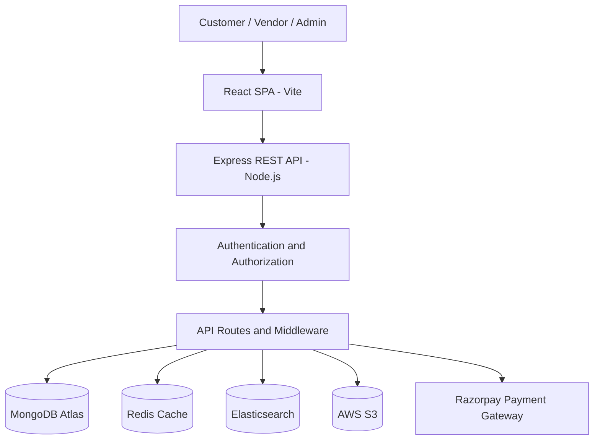

# Nexvia FS01 – Multi-Vendor Marketplace
## System Architecture Documentation

### 1. Project Overview

Nexvia FS01 is a multi-vendor e-commerce marketplace that connects customers, vendors and administrators through a centralized web application.

The platform supports product browsing, vendor management, shopping carts, order processing, online payments, coupons, invoices, product search and customer reviews.

### 2. Technology Stack

| Layer | Technology |
|---|---|
| Frontend | React.js, Vite |
| Backend | Node.js, Express.js |
| Database | MongoDB Atlas, Mongoose |
| Caching | Redis, ioredis |
| Search Engine | Elasticsearch |
| Image Storage | AWS S3 |
| Payment Gateway | Razorpay |
| Frontend Deployment | Vercel |
| Backend Deployment | Render |

### 3. System Architecture Diagram

### 4. Application Components

#### 4.1 Frontend

The frontend is developed using React.js and Vite.

Main responsibilities:
- User registration and login
- Product browsing and product details
- Shopping cart management
- Checkout and payment
- Vendor dashboard
- Admin dashboard
- Product reviews and ratings
- Order history and invoices

Deployment: Vercel.

#### 4.2 Backend

The backend uses Node.js and Express.js to provide REST APIs.

Main responsibilities:
- Authentication and authorization
- Product and vendor management
- Cart and order processing
- Payment verification
- Coupon management
- Review submission
- Invoice generation
- Administrative operations

Security middleware includes Helmet, CORS and express-rate-limit.

#### 4.3 Database – MongoDB Atlas

MongoDB Atlas is the primary database and source of truth.

Mongoose models include:
- User
- Product
- Cart
- Order
- Coupon
- Review

MongoDB stores application records and authoritative product and order information.

#### 4.4 Redis

Redis is integrated using ioredis.

It provides caching support for short-lived cart/session-related data and helps reduce repeated database operations.

#### 4.5 Elasticsearch

Elasticsearch provides product search functionality.

Product information is indexed using fields such as:
- Product name
- Description
- Category
- Price
- Vendor ID
- Active status

MongoDB remains the authoritative data store.

#### 4.6 AWS S3

AWS S3 is used for product image storage.

Image upload workflow:
1. Frontend requests a temporary upload URL.
2. Backend validates the image content type.
3. Backend generates a presigned S3 upload URL.
4. Frontend uploads the image to S3.
5. Backend validates image keys and generates temporary viewing URLs.

Supported formats: JPEG, PNG and WebP.

#### 4.7 Razorpay

Razorpay is integrated for payment processing.

Payment workflow:
1. Customer proceeds to checkout.
2. Backend creates a payment order.
3. Customer completes payment using Razorpay.
4. Backend verifies the payment signature.
5. Order payment status is updated after successful verification.

The current project uses Razorpay test mode. Production marketplace split settlements require an approved Razorpay Route/Connect product and onboarded vendors.

### 5. User Roles

**Customer**
- Register and log in
- Browse products
- Add products to cart
- Apply coupons
- Place orders
- Make payments
- View orders and invoices
- Review eligible delivered purchases

**Vendor**
- Apply for vendor status
- Manage own products
- View own order items

**Admin**
- Approve vendors
- Manage products and coupons
- View marketplace analytics

### 6. API Architecture

The Express backend organizes functionality into REST API route modules.

| API Base Path | Responsibility |
|---|---|
| /api/auth | Authentication |
| /api/vendors | Vendor operations |
| /api/products | Product operations |
| /api/cart | Cart operations |
| /api/orders | Order management |
| /api/payments | Payment processing |
| /api/reviews | Product reviews |
| /api/coupons | Coupon management |
| /api/invoices | Invoice operations |
| /api/admin | Admin operations |
| /api/health | API health check |

### 7. Important Data Flows

#### Product Search
Customer → React Frontend → Express API → Elasticsearch → Search Results → Frontend.

#### Shopping and Checkout
Customer → Cart → Backend → MongoDB → Order Creation → Razorpay Payment → Payment Verification → Order Status Update.

#### Product Image Upload
Frontend → Backend → Presigned S3 URL → AWS S3 → Image Reference.

#### Product Review
Customer → Review Form → Express API → Order Eligibility Verification → MongoDB Review Storage → Product Rating Statistics.

### 8. Security Architecture

The application follows these security principles:

- Authentication and authorization for protected operations.
- Server-side validation of product prices and order totals.
- Never trust client-submitted roles, commissions or ownership.
- Server-side payment signature verification.
- Environment variables for cloud credentials and secrets.
- Restricted image content types and image key validation.
- Helmet security headers.
- CORS configuration.
- API rate limiting.
- Centralized error handling.

### 9. Deployment Architecture

| Component | Deployment Platform |
|---|---|
| Frontend | Vercel |
| Backend API | Render |
| Database | MongoDB Atlas |
| Cache | Redis |
| Search | Elasticsearch Cloud |
| Image Storage | AWS S3 |
| Payment | Razorpay Test Mode |

Frontend URL:
https://nexvia-fs-01-multi-vendor-marketpla.vercel.app/

Backend URL:
https://nexvia-fs01-multivendor-marketplace.onrender.com

Health endpoint:
https://nexvia-fs01-multivendor-marketplace.onrender.com/api/health

### 10. Conclusion

Nexvia FS01 demonstrates a modular multi-vendor marketplace architecture integrating a React frontend, Express backend, MongoDB database and supporting cloud services.

The architecture separates application responsibilities, supports independent service integrations and provides a foundation for future scalability and marketplace enhancements.
